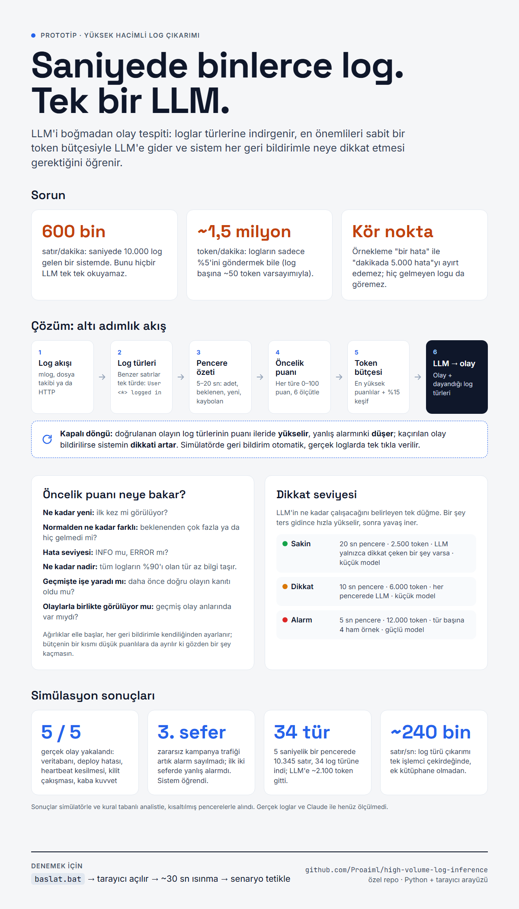

# Log Çıkarım Prototipi

Saniyede binlerce log gelen bir sistemde LLM'i boğmadan olay tespiti yapan bir prototip.
Benzer log satırları tek bir log türünde (şablon) toplanır, her pencerede her log türüne 0-100 arası bir
öncelik puanı verilir ve sabit bir token bütçesine sığanlar LLM'e özet olarak gider. LLM'in bulduğu olaylar doğrulandıkça ya da
reddedildikçe sistem neye dikkat etmesi gerektiğini öğrenir.

Sistem **sıfırdan** başlar: geçmiş log yoktur, ilk pencerelerde "normal"in ne olduğunu kendisi öğrenir.

## Poster

Projeyi tek sayfada anlatan poster: [PNG](docs/poster/poster.png) · [PDF (baskı için)](docs/poster/poster.pdf) · [HTML](docs/poster/poster.html)



## Kurulum (Windows)

1. Python 3.10 veya üzeri kurulu olsun ([python.org](https://www.python.org/downloads/)).
   Kurulumda **"Add python.exe to PATH"** kutusunu işaretleyin.
2. Bu klasördeki **`baslat.bat`** dosyasına çift tıklayın.
3. Tarayıcı kendiliğinden açılır: <http://localhost:8080>
   (8080 doluysa bir sonraki boş port seçilir; doğru adres siyah pencerede yazar).

İlk çalıştırmada bir sanal ortam (`.venv`) kurulur ve Claude bağlantısı için `anthropic` paketi
indirilir (internet gerekir). İnternet yoksa da uygulama çalışır; sadece Claude modu kapalı olur.
Başka hiçbir kurulum, veritabanı ya da Docker gerekmez.

macOS / Linux: `sh baslat.sh`

## İlk kullanım (5 dakika)

1. **Isınmayı bekleyin (~30 sn).** Üstteki mavi bant kaybolunca sistem normali öğrenmiştir.
   Simülatör bu sırada mlog tarzı bir e-ticaret uygulaması gibi saniyede 2.000 log üretir.
2. **Bir senaryo tetikleyin.** Sağdaki "Senaryo tetikle" kutusundan örneğin *Veritabanı bağlantı sorunu*.
   Dikkat seviyesi birkaç saniye içinde *Alarm*'a çıkar, LLM'e özet gider ve "Olaylar" listesine olay düşer.
3. En alttaki **"Pencereler: LLM'e ne gitti?"** bölümünden herhangi bir pencereyi seçin (ya da dikkat grafiğinde
   bir noktaya, bir olaydaki pencere bağlantısına tıklayın). Tablodaki bir satıra tıklayınca o log türünün ne olduğu,
   neden o puanı aldığı ve LLM'e neden gidip gitmediği düz Türkçeyle açıklanır. LLM'e giden özet metninin tamamı da oradadır.
4. **Öğrenmeyi izleyin.** *Kampanya trafiği (zararsız)* senaryosunu birkaç dakika arayla 3 kez tetikleyin.
   İlk iki seferde yanlış alarm üretir; üçüncüde sistem bu şablonun zararsız olduğunu öğrenmiş olur ve alarm üretmez.
   "Sistem neye önem veriyor?" kutusundaki ağırlıklar ve "İsabet / yakalama" göstergesi buna göre değişir.
5. *Zamanlayıcı durdu* senaryosu, gelmesi gereken logların **gelmemesini** (heartbeat kesilmesi) yakalamayı gösterir.

Simülatör hangi senaryonun gerçek olay olduğunu bildiği için geri bildirimi otomatik verir.
Gerçek loglarla çalışırken her olayın altındaki **Doğru olay / Yanlış alarm** düğmelerini kullanın,
LLM'in kaçırdığı bir olay olursa **Kaçırılan olay bildir**'e basın.

## Claude'u bağlamak

Varsayılan analist, anahtar gerektirmeyen kural tabanlı bir simülasyondur. Gerçek LLM için:

1. Sağ üstte **Ayarlar** → *Claude (Anthropic API)* seçin.
2. API anahtarınızı girin ve kaydedin. Anahtar sadece sunucunun belleğinde tutulur, diske yazılmaz.
   Alternatif: başlatmadan önce `ANTHROPIC_API_KEY` ortam değişkenini ayarlayın.

Hangi dikkat seviyesinde hangi modelin kullanılacağı `ayarlar.json` içindedir:
sakin ve dikkat seviyelerinde `claude-haiku-5-5`, alarm seviyesinde `claude-opus-5-5`.
Günlük token bütçesi dolunca LLM çağrıları durur, sadece ucuz dedektörler çalışmaya devam eder.

## Kendi loglarınızı bağlamak

Simülatörü duraklatın (ya da `baslat.bat --no-sim` ile başlatın) ve loglarınızı şu yollardan biriyle gönderin:

```powershell
# HTTP ile (düz metin, NDJSON ya da JSON dizi)
Invoke-RestMethod -Method Post -Uri http://localhost:8080/api/ingest -ContentType 'text/plain; charset=utf-8' -Body (Get-Content C:\loglar\app.log -Raw)
```

```powershell
# Bir log dosyasını canlı takip etmek (tail -f gibi)
.\baslat.bat --tail C:\loglar\app.log
```

Kabul edilen satır biçimleri:

```
2026-11-26T12:04:01.123 ERROR [payment-svc@host-2] mesaj          (mlog tarzı)
{"ts": "...", "level": "error", "service": "billing", "msg": "..."}  (JSON)
2026-11-26 12:04:01 WARNING disk usage 91% on /dev/sda1              (düz metin)
```

Başka makinelerden log almak için `--host 0.0.0.0` ile başlatın (güvenlik duvarında portu açmanız gerekir).
Tüm seçenekler: `.venv\Scripts\python.exe app.py --help`

## Nasıl çalışır

Sistem kapalı döngü çalışır: LLM'in bulduğu olay doğrulanınca ya da reddedilince (simülatörde otomatik,
gerçek loglarda düğmeyle) öncelik puanının ağırlıkları, log türlerinin geçmişi ve dikkat seviyesinin alt sınırı güncellenir.


| Adım | Ne yapar | Dosya |
|---|---|---|
| Şablon çıkarımı | IP, kimlik, sayı gibi değişken kısımları `<*>` yapar; Drain algoritmasıyla benzer logları aynı şablona toplar | `engine/parser.py`, `engine/miner.py` |
| Pencere | Her pencerede şablon başına adet, beklenen adet, yeni / artan / kaybolan şablonlar | `engine/core.py` |
| Öncelik puanı | 6 ölçütün ağırlıklı toplamı (ne kadar yeni, geçmişte işe yaradı mı, olaylarla birlikte görülüyor mu, ne kadar nadir, normalden ne kadar farklı, hata seviyesi) → 0-100 puan | `engine/priority.py` |
| Seçim | Sabit token bütçesine en yüksek skorlu şablonlar, bütçenin %15'i keşfe | `engine/core.py` |
| Dikkat seviyesi | Anomalide hızlı yükselir, yavaş iner; pencere süresini, bütçeyi ve modeli belirler | `engine/attention.py` |
| LLM | Özetten olay çıkarır ve kanıt olarak kullandığı şablon ID'lerini söyler | `engine/analyst.py` |
| Geri besleme | Doğru olay → kanıt şablonlarının skoru artar; yanlış alarm → düşer; kaçırılan olay → dikkat tabanı yükselir | `engine/core.py` |

## Ayarlar (`ayarlar.json`)

| Alan | Anlamı |
|---|---|
| `seviyeler.*.pencere_sn` | Pencere süresi. Demo için kısa (20/10/5 sn); gerçek ortamda 60 sn ve üstü önerilir |
| `seviyeler.*.token_butcesi` | Bir pencere özetine ayrılan en fazla token |
| `seviyeler.*.ornek_sayisi` | Önemli şablonlar için özete eklenen ham log örneği sayısı |
| `seviyeler.*.model`, `effort` | Claude modunda o seviyede kullanılan model ve düşünme seviyesi |
| `isinma_pencere`, `isinma_pencere_sn` | Sıfırdan başlarken LLM'in çağrılmadığı öğrenme pencereleri |
| `kesif_orani` | Bütçenin öncelik listesine girmeyen şablonlara ayrılan payı |
| `sakin_cagri_esigi`, `saglik_kontrolu_her` | Sakin seviyede LLM'in ne zaman çağrılacağı |
| `gunluk_token_butcesi` | Günlük üst sınır; dolunca LLM çağrılmaz |
| `oncelik_modeli.*` | Öncelik puanındaki ölçütlerin başlangıç ağırlıkları, öğrenme hızı, başlangıca geri çekme (L2) |
| `simulator.hiz` | Simülatörün saniyedeki log sayısı (arayüzden de değişir) |

## Prototipin sınırları

- Her şey bellekte tutulur; uygulama kapanınca öğrenilenler sıfırlanır.
- Tek süreçte çalışır; yaklaşık saniyede 20 bin loga kadar rahat işler. Daha yüksek hacimde
  şablon çıkarımı ayrı işçilere / Kafka tüketicilerine bölünmelidir.
- Pencere zamanı logların kendi zaman damgasına değil, sunucuya geliş zamanına göredir.
- LLM'e "ham loglara in" aracı (drill-down) henüz yok; alarm seviyesinde daha fazla ham örnek gönderilerek telafi edilir.
- Simülasyon analisti kural tabanlıdır; gerçek LLM davranışı için Claude modunu kullanın.
